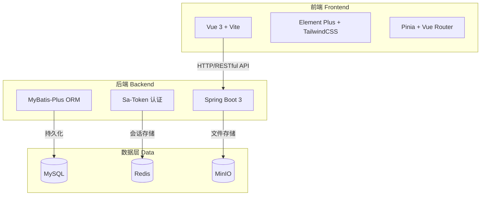
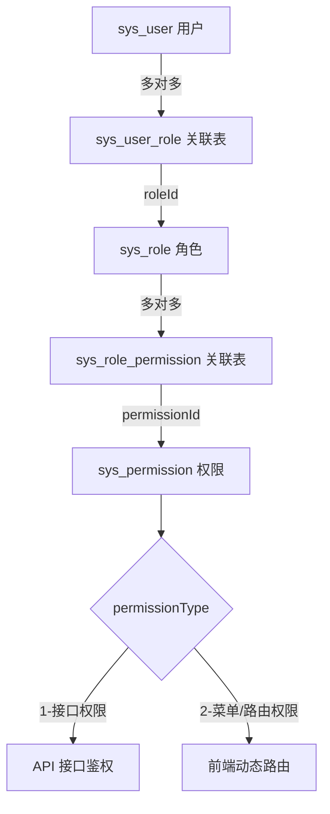
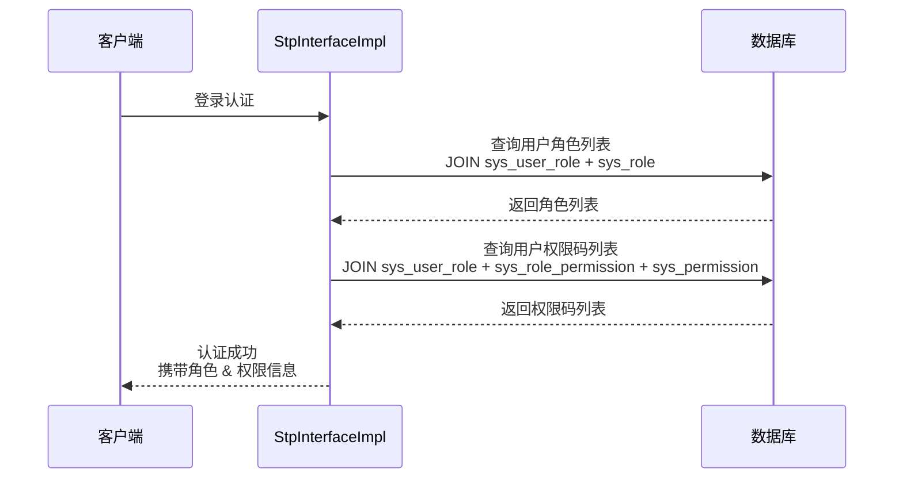

# 单体通用开发基座 (Single Admin Base)

基于 Spring Boot 3 + Vue 3 的基础单体通用开发基座，采用前后端分离架构，内置 RBAC 权限控制、动态菜单路由、部门岗位、字典参数、操作日志、代码生成、文件管理等通用系统能力，可作为各类业务系统的起始模板。

---

## 功能特性

- **RBAC 权限系统**：基于“用户-角色-权限”多对多模型的细粒度权限控制，支持接口权限与菜单/按钮权限
- **动态菜单与路由**：根据用户权限自动生成前端菜单与路由，实现页面级权限控制
- **用户与角色管理**：用户增删改查、状态启用/禁用、角色分配、多角色支持
- **部门与岗位管理**：树形部门结构、岗位配置、用户关联
- **字典与参数管理**：系统字典、业务参数、运行配置维护
- **系统配置管理**：站点标题、主题色、备案号、对象存储等配置集中维护，前后端实时生效
- **操作日志**：登录日志与操作日志记录，支持审计与查询
- **在线用户管理**：实时监控在线用户，支持会话查看与强制下线
- **文件管理**：集成 MinIO / 阿里云 OSS / 七牛云对象存储，支持存储服务商配置切换、文件上传与统一管理
- **代码生成器**：根据数据库表快速生成前后端基础代码
- **动态主题**：支持自定义主题色、字体大小、深色模式，可切换后端统一下发或前端自主配置
- **多环境配置**：支持 dev / test / prod 等多环境配置切换
- **Docker 部署**：提供完整的 Docker Compose 编排方案，一键部署全部服务

---

## 技术栈

### 后端

| 技术 | 版本 | 说明 |
|------|------|------|
| Java | 25 | |
| Spring Boot | 3.5.14 | 基础框架 |
| Sa-Token | 1.40.0 | 认证鉴权（整合 Redis） |
| MyBatis-Plus | 3.5.14 | ORM 框架 |
| MySQL | 8.0+ | 数据库 |
| Redis | - | 缓存 / 会话存储 |
| MinIO | 8.5.7 | 对象存储 |
| Knife4j | 4.5.0 | API 文档 |
| Undertow | - | Web 容器（替代 Tomcat） |

### 前端

| 技术 | 版本 | 说明 |
|------|------|------|
| Vue | 3.5.x | 渐进式框架 |
| Vite | 7.3.x | 构建工具 |
| Vue Router | 5.0.x | 路由管理（含动态路由） |
| Pinia | 3.0.x | 状态管理 |
| Element Plus | 2.13.x | UI 组件库 |
| ECharts | 6.x | 图表库 |
| TailwindCSS | 3.4.x | 原子化 CSS |
| Axios | 1.13.x | HTTP 请求 |

---

## 系统架构

### 整体架构



### RBAC 权限模型



### 权限查询流程



---

## 项目结构

```
single-admin/
├── backend/                          # 后端项目 (Spring Boot)
│   ├── src/main/java/com/hfh/api/
│   │   ├── config/                   # 配置类（Sa-Token、Redis、MyBatis-Plus）
│   │   ├── modules/
│   │   │   └── system/               # system 模块（用户、角色、权限、部门、岗位、字典、参数、日志）
│   │   ├── base/                     # 基础类（Controller、Entity）
│   │   ├── utils/                    # 工具类
│   │   ├── exception/                # 异常处理
│   │   └── generator/                # 代码生成器
│   └── src/main/resources/
│       ├── mapper/                   # MyBatis XML 映射
│       │   └── system/               # system 模块 Mapper XML
│       ├── db/migration/V1__init.sql # Flyway 迁移脚本（建表 + 初始化数据）
│       └── application*.yaml         # 配置文件
│
├── frontend/                         # 前端项目 (Vue 3 + Vite)
│   ├── src/
│   │   ├── api/                      # API 接口层
│   │   ├── views/                    # 页面视图
│   │   │   ├── admin/
│   │   │   │   ├── dashboard/        # 数据看板
│   │   │   │   ├── system/           # 系统管理（用户/角色/权限/部门/岗位/字典/参数/日志）
│   │   │   │   └── layout/           # 布局组件
│   │   │   └── login/                # 登录页
│   │   ├── router/                   # 路由配置（静态 + 动态）
│   │   ├── stores/                   # Pinia 状态管理
│   │   ├── components/               # 公共组件
│   │   └── utils/                    # 工具函数
│   └── package.json
│
├── mysql/                            # MySQL 配置与初始化脚本
│   ├── .env
│   └── db_single_admin.sql           # 历史 SQL dump（已废弃，仅作参考）
├── redis/                            # Redis 配置
├── minio/                            # MinIO 配置
├── docker-compose.yml                # Docker 编排配置
├── .env / .env.example               # 部署环境变量
└── docs/                             # 项目文档
    ├── IMPROVEMENTS.md               # 改进评估清单与推进计划
    └── test-report.md                # 单元测试与覆盖率报告
```

---

## 数据库设计

### 表结构概览

| 表名前缀 | 模块 | 说明 |
|----------|------|------|
| `sys_` | 系统模块 | 用户、角色、权限、部门、岗位、字典、参数、日志等 |

### 核心权限表

- **sys_user** — 用户表
- **sys_role** — 角色表
- **sys_permission** — 权限表（支持接口权限 / 菜单路由权限两种类型）
- **sys_user_role** — 用户角色关联表（多对多）
- **sys_role_permission** — 角色权限关联表（多对多）

> 详细建表 SQL 请参见 `backend/src/main/resources/db/migration/V1__init.sql`（由 Flyway 在启动时执行）

---

## 快速开始

### 环境要求

- Node.js >= 20.19.0
- pnpm（通过 `corepack enable pnpm` 启用）
- Java >= 25
- Maven 3.x
- MySQL 8.0+
- Redis
- MinIO

### 后端启动

```bash
# 1. 创建空数据库（表结构与初始化数据由后端启动时的 Flyway 自动执行）
mysql -u root -p -e "CREATE DATABASE IF NOT EXISTS db_single_admin CHARACTER SET utf8mb4 COLLATE utf8mb4_unicode_ci"

# 2. 配置本地凭据
# 复制 backend/.env.example 为 backend/.env，填写数据库与 Redis 密码

[Environment]::SetEnvironmentVariable('JAVA_HOME','C:\Program Files\BellSoft\LibericaJDK-25','User')

# 3. 启动后端服务
$env:JAVA_HOME = 'C:\Program Files\BellSoft\LibericaJDK-25'
$env:Path = "$env:JAVA_HOME\bin;" + $env:Path
java --version
javac --version

cd backend
./mvnw spring-boot:run
```

后端服务默认运行在 `http://localhost:9999`（端口可通过 `SERVER_PORT` 环境变量覆盖），API 文档地址：`http://localhost:9999/doc.html`，健康检查：`http://localhost:9999/actuator/health`，Prometheus 指标：`http://localhost:9999/actuator/prometheus`

### 前端启动

```bash
# 1. 安装依赖（项目使用 pnpm，锁文件已纳入版本控制）
cd frontend
corepack enable pnpm
pnpm install

# 2. 启动开发服务器
pnpm dev
```

前端开发服务器默认运行在 `http://localhost:9998`

### Docker 部署（推荐）

```bash
# 一键启动全部服务（在项目根目录执行）
docker compose up -d
```

Docker Compose 将自动启动以下服务：
- MySQL 8.0
- Redis
- MinIO
- 后端 API 服务
- 前端 Nginx 服务

---

## 可用命令

### 前端

| 命令 | 说明 |
|------|------|
| `pnpm dev` | 开发环境启动 |
| `pnpm dev:test` | 测试环境启动 |
| `pnpm build` | 生产环境构建 |
| `pnpm build:test` | 测试环境构建 |
| `pnpm lint` | 代码检查 |
| `pnpm format` | 代码格式化 |

### 后端

| 命令 | 说明 |
|------|------|
| `./mvnw spring-boot:run` | 启动应用（dev 环境） |
| `./mvnw package -DskipTests` | 打包 JAR |
| `java -jar backend.jar --spring.profiles.active=prod` | 生产环境运行 |

---

## 文档

- [文档索引](docs/README.md)
- [改进评估清单](docs/IMPROVEMENTS.md)
- [测试与覆盖率报告](docs/test-report.md)
- [贡献指南](docs/CONTRIBUTING.md)
- [安全策略](docs/SECURITY.md)
- [变更日志](docs/CHANGELOG.md)

---

## 许可证

本项目基于 [MIT License](LICENSE) 开源。
