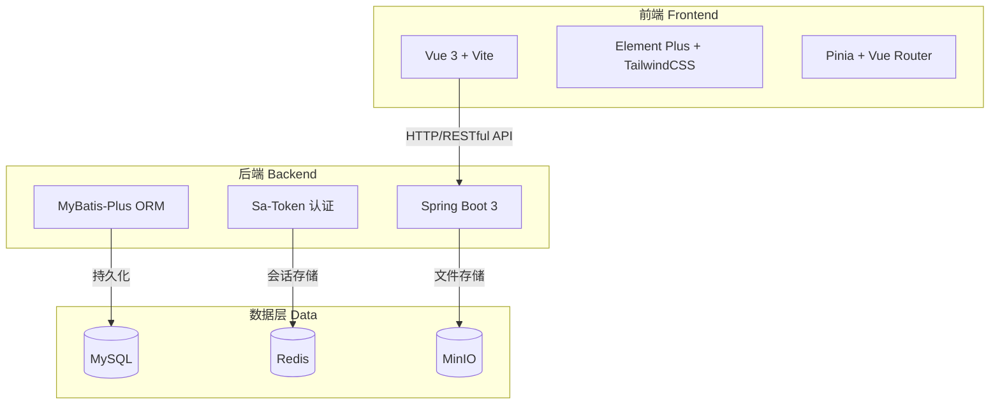
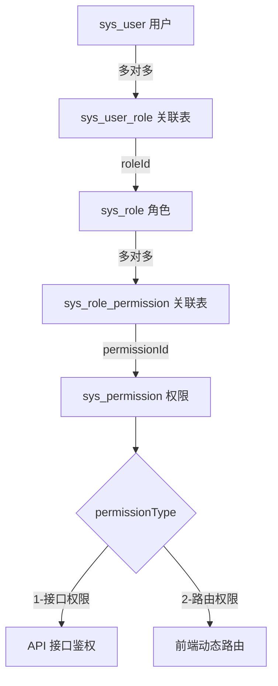
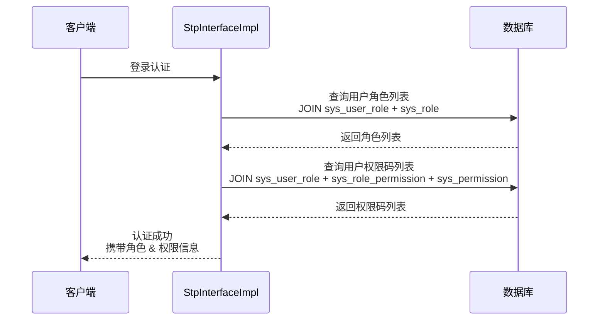

# 问卷管理系统 (Questionnaire System)

基于 Spring Boot 3 + Vue 3 的问卷管理与患者信息采集系统，采用前后端分离架构，内置 RBAC 权限控制、动态路由、数据统计看板等核心功能。

---

## 功能特性

- **问卷管理**：支持问卷、题目分组、题目及选项的完整 CRUD，提供问卷预览与填写功能
- **患者管理**：患者信息维护，支持患者关联问卷并在线填写
- **RBAC 权限系统**：基于"用户-角色-权限"多对多模型的细粒度权限控制，支持接口权限与路由权限
- **动态路由**：根据用户权限自动生成前端菜单和路由，实现页面级权限控制
- **数据统计**：基于 ECharts 的可视化仪表盘，展示用户、问卷、患者等多维统计数据
- **文件管理**：集成 MinIO 对象存储，支持文件上传与管理
- **机构管理**：支持多机构（医疗机构）的分级管理
- **Docker 部署**：提供完整的 Docker Compose 编排方案，一键部署全部服务

---

## 技术栈

### 后端

| 技术 | 版本 | 说明 |
|------|------|------|
| Java | 25 | |
| Spring Boot | 3.5.14 | 基础框架 |
| Sa-Token | 1.40.0 | 认证鉴权（整合 Redis） |
| MyBatis-Plus | 3.5.14 | ORM 框架 |
| MySQL | 8.0+ | 数据库 |
| Redis | - | 缓存 / 会话存储 |
| MinIO | 8.5.7 | 对象存储 |
| Knife4j | 4.5.0 | API 文档 |
| Undertow | - | Web 容器（替代 Tomcat） |

### 前端

| 技术 | 版本 | 说明 |
|------|------|------|
| Vue | 3.5.x | 渐进式框架 |
| Vite | 7.3.x | 构建工具 |
| Vue Router | 5.0.x | 路由管理（含动态路由） |
| Pinia | 3.0.x | 状态管理 |
| Element Plus | 2.13.x | UI 组件库 |
| ECharts | 6.x | 图表库 |
| TailwindCSS | 3.4.x | 原子化 CSS |
| Axios | 1.13.x | HTTP 请求 |

---

## 系统架构

### 整体架构



### RBAC 权限模型



### 权限查询流程



---

## 项目结构

```
questionnaire-system/
├── backend/                          # 后端项目 (Spring Boot)
│   ├── src/main/java/com/hfh/api/
│   │   ├── config/                   # 配置类（SaToken、Redis、MyBatis-Plus）
│   │   ├── modules/
│   │   │   └── system/               # system 模块（用户、角色、权限等）
│   │   ├── base/                     # 基础类（Controller、Entity）
│   │   ├── utils/                    # 工具类
│   │   ├── exception/                # 异常处理
│   │   └── generator/                # 代码生成器
│   └── src/main/resources/
│       ├── mapper/                   # MyBatis XML 映射
│       │   ├── system/               # system 模块 Mapper XML
│       │   ├── form/                 # 问卷相关 Mapper XML
│       │   └── fill/                 # 填写相关 Mapper XML
│       ├── sql/                      # 数据库脚本
│       └── application*.yaml         # 配置文件
│
├── frontend/                         # 前端项目 (Vue 3 + Vite)
│   ├── src/
│   │   ├── api/                      # API 接口层
│   │   ├── views/                    # 页面视图
│   │   │   ├── admin/
│   │   │   │   ├── dashboard/        # 数据看板
│   │   │   │   ├── form/             # 问卷管理
│   │   │   │   ├── fill/             # 填写管理
│   │   │   │   ├── system/           # 系统管理（用户/角色/权限/机构）
│   │   │   │   └── layout/           # 布局组件
│   │   │   └── login/                # 登录页
│   │   ├── router/                   # 路由配置（静态 + 动态）
│   │   ├── stores/                   # Pinia 状态管理
│   │   ├── components/               # 公共组件
│   │   └── utils/                    # 工具函数
│   └── package.json
│
└── docker/                           # Docker 部署
    ├── docker-compose.yml            # 编排配置
    ├── mysql/                        # MySQL 配置
    ├── redis/                        # Redis 配置
    ├── minio/                        # MinIO 配置
    ├── backend/                      # 后端部署配置
    └── frontend/                     # 前端 Nginx 配置
```

---

## 数据库设计

### 表结构概览

| 表名前缀 | 模块 | 说明 |
|----------|------|------|
| `sys_` | 系统模块 | 用户、角色、权限、机构等 |
| `qus_` | 问卷模块 | 问卷、题目分组、题目、选项、问卷类型 |
| `ins_` | 业务模块 | 患者、患者问卷关联、患者作答 |

### 核心权限表

- **sys_user** — 用户表
- **sys_role** — 角色表
- **sys_permission** — 权限表（支持接口权限 / 路由权限两种类型）
- **sys_user_role** — 用户角色关联表（多对多）
- **sys_role_permission** — 角色权限关联表（多对多）

> 详细建表 SQL 请参见 `backend/src/main/resources/sql/db_questionnaire.sql`

---

## 快速开始

### 环境要求

- Node.js >= 20.19.0
- Java >= 25
- Maven 3.x
- MySQL 8.0+
- Redis
- MinIO

### 后端启动

```bash
# 1. 创建数据库并导入初始化脚本
mysql -u root -p < backend/src/main/resources/sql/db_questionnaire.sql

# 2. 修改数据库连接配置
# 编辑 backend/src/main/resources/application-dev.yaml

# 3. 启动后端服务
cd backend
./mvnw spring-boot:run
```

后端服务默认运行在 `http://localhost:8080`，API 文档地址：`http://localhost:8080/doc.html`

### 前端启动

```bash
# 1. 安装依赖
cd frontend
npm install

# 2. 启动开发服务器
npm run dev
```

前端开发服务器默认运行在 `http://localhost:5173`

### Docker 部署（推荐）

```bash
# 一键启动全部服务
cd docker
docker compose up -d
```

Docker Compose 将自动启动以下服务：
- MySQL 8.0
- Redis
- MinIO
- 后端 API 服务
- 前端 Nginx 服务

---

## 可用命令

### 前端

| 命令 | 说明 |
|------|------|
| `npm run dev` | 开发环境启动 |
| `npm run dev:test` | 测试环境启动 |
| `npm run build` | 生产环境构建 |
| `npm run build:test` | 测试环境构建 |
| `npm run lint` | 代码检查 |
| `npm run format` | 代码格式化 |

### 后端

| 命令 | 说明 |
|------|------|
| `./mvnw spring-boot:run` | 启动应用（dev 环境） |
| `./mvnw package -DskipTests` | 打包 JAR |
| `java -jar backend.jar --spring.profiles.active=prod` | 生产环境运行 |

---

## 许可证

MIT License
